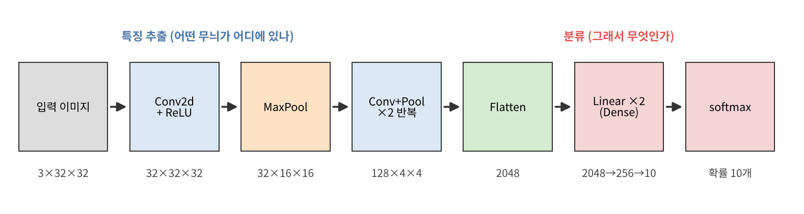
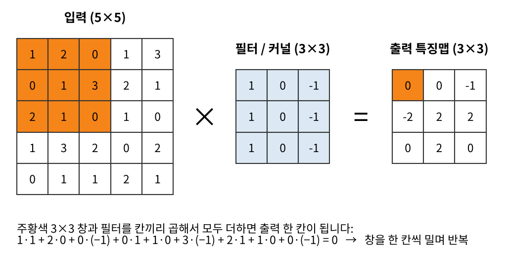
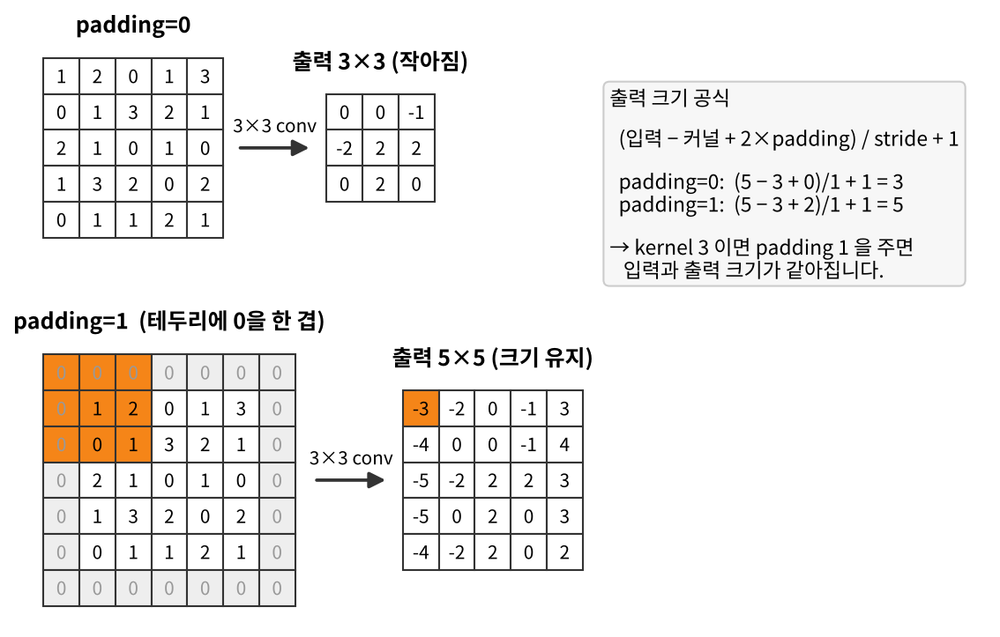
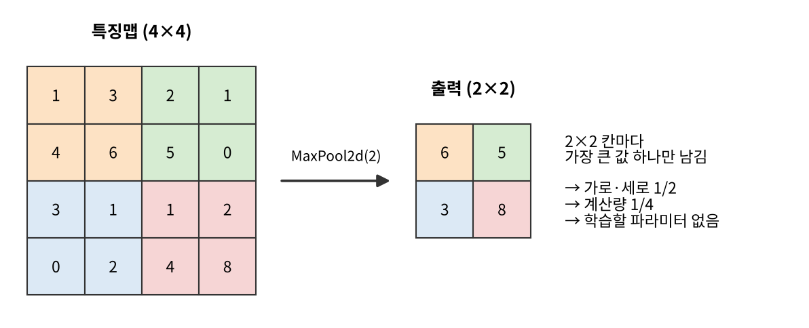
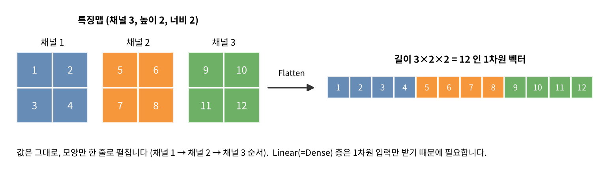
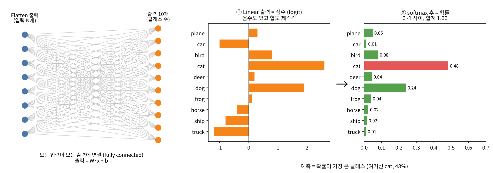

# CNN 미니 프로젝트 — 기본 구조 한눈에 보기

`base.ipynb` 의 기본 CNN 이 **무엇을 하는지** 층 하나씩 그림으로 설명합니다.
전이학습 없이 처음부터 학습하는 모델이고, Google Colab + PyTorch 로 진행합니다.



CNN 은 크게 두 부분입니다.

- **특징 추출** — `Conv2d` 로 무늬를 찾고 `MaxPool` 로 크기를 줄이는 블록을 반복합니다. 앞쪽 층은 선·모서리 같은 단순한 무늬를, 뒤쪽 층은 눈·바퀴 같은 복잡한 모양을 찾습니다.
- **분류** — `Flatten` 으로 한 줄로 펼친 뒤 `Linear(Dense)` 가 "그래서 어떤 클래스인가" 를 점수로 냅니다.

```python
# base.ipynb 의 BaseCNN (요약)
nn.Conv2d(3, 32, kernel_size=3, padding=1), nn.ReLU(), nn.MaxPool2d(2),
nn.Conv2d(32, 64, kernel_size=3, padding=1), nn.ReLU(), nn.MaxPool2d(2),
nn.Conv2d(64, 128, kernel_size=3, padding=1), nn.ReLU(), nn.MaxPool2d(2),
nn.Flatten(),
nn.Linear(n_flat, 256), nn.ReLU(),
nn.Linear(256, NUM_CLASSES)            # = Keras 의 layers.Dense(10, activation="softmax")
```

---

## 1. Conv2d — 필터로 훑으며 무늬 찾기



**무엇인가** 작은 숫자 격자인 **필터(커널)** 를 이미지 위에서 한 칸씩 밀면서, 겹친 칸끼리 곱해 모두 더합니다. 그 결과를 모은 것이 **특징맵(feature map)** 입니다.

**뭘 하는 작업인가** "이 위치에 이런 무늬가 있나?" 를 검사합니다. 위 그림의 필터는 왼쪽이 밝고 오른쪽이 어두운 **세로 경계**에서 큰 값이 나옵니다. 필터의 숫자는 사람이 정하지 않습니다. **학습으로 자동으로 정해집니다.**

```python
nn.Conv2d(in_channels=3, out_channels=32, kernel_size=3, padding=1)
```

| 인자 | 뜻 |
|---|---|
| `in_channels=3` | 입력 채널 수 (컬러 RGB = 3) |
| `out_channels=32` | 필터 개수 = 출력 채널 수. 필터 32개가 서로 다른 무늬 32가지를 찾음 |
| `kernel_size=3` | 필터 크기 3×3 |
| `padding=1` | 테두리에 0 한 겹 (→ 2번) |

- 파라미터 수 = `in × out × 3 × 3 + out(bias)` → 첫 층은 `3×32×9 + 32 = 896` 개
- 바로 뒤의 `ReLU` 는 음수를 0 으로 바꿉니다. 이게 없으면 층을 아무리 쌓아도 하나의 큰 곱셈과 같아집니다.

---

## 2. Padding — 테두리에 0 을 덧대 크기 지키기



**무엇인가** 입력의 바깥 테두리에 **0 을 채운 칸**을 덧붙입니다. `padding=1` 이면 한 겹입니다.

**뭘 하는 작업인가** 두 가지 문제를 막습니다.

1. **크기가 줄어드는 문제** — 3×3 필터는 padding 없이 쓰면 출력이 가로·세로 2칸씩 줄어듭니다. 층을 쌓을수록 이미지가 금방 사라집니다.
2. **가장자리 정보 손실** — padding 이 없으면 모서리 픽셀은 필터에 한 번만 닿고, 가운데 픽셀은 9번 닿습니다.

**출력 크기 공식** (Day 2 2교시)

```
출력 = (입력 − 커널 + 2 × padding) / stride + 1
```

`kernel_size=3, padding=1` 이면 출력 = 입력. 그래서 `base.ipynb` 의 Conv 층은 **크기를 바꾸지 않고 채널 수만 바꿉니다.** 크기 줄이기는 Pooling 이 맡습니다.

---

## 3. Pooling — 대표값만 남기고 크기 절반으로



**무엇인가** `MaxPool2d(2)` 는 특징맵을 2×2 칸으로 나누고 **각 칸에서 가장 큰 값 하나만** 남깁니다.

**뭘 하는 작업인가**

- **크기 축소** — 가로·세로가 절반, 다음 층의 계산량은 1/4 이 됩니다.
- **위치에 덜 민감하게** — 무늬가 한두 칸 옆으로 움직여도 최댓값은 대체로 그대로입니다. "정확히 어디에" 보다 "근처에 있다" 가 중요해집니다.
- **학습할 파라미터가 없습니다.** 규칙대로 고를 뿐입니다.
- 채널 수는 바뀌지 않습니다 (채널마다 따로 적용).

```python
nn.MaxPool2d(2)        # (32, 32, 32) → (32, 16, 16)
```

---

## 4. Flatten — 3차원 특징맵을 한 줄로 펼치기



**무엇인가** (채널, 높이, 너비) 모양의 특징맵을 **값은 그대로 두고 1차원 벡터로** 다시 늘어놓습니다.

**뭘 하는 작업인가** 특징 추출과 분류를 잇는 연결부입니다. 다음 층인 `Linear(Dense)` 는 1차원 입력만 받기 때문에 필요합니다. 계산도 파라미터도 없습니다.

```python
nn.Flatten()           # (128, 4, 4) → 128 × 4 × 4 = 2048
```

> ⚠️ Flatten 길이는 **이미지 크기에 따라 달라집니다.** 32×32 면 2048, 48×48 이면 128×6×6 = 4608.
> `base.ipynb` 는 `n_flat = 128 * (IMG_SIZE // 8) ** 2` 로 계산하므로 `IMG_SIZE` 만 바꾸면 됩니다 (MaxPool 3번 → 크기 1/8).

---

## 5. Dense(10, softmax) — 클래스별 점수를 확률로



**무엇인가** `Dense` 는 **모든 입력이 모든 출력에 연결된 층** (fully connected) 입니다. 출력 하나는 `가중치 · 입력 + bias` 입니다. `10` 은 출력 개수 = **클래스 수**입니다.

**뭘 하는 작업인가** 두 단계로 최종 답을 냅니다.

1. **Dense (Linear)** — Flatten 벡터를 보고 클래스마다 **점수(logit)** 를 매깁니다. 음수도 나오고 합계도 제각각입니다.
2. **softmax** — 점수를 **0~1 사이, 합이 1 인 확률**로 바꿉니다. 점수가 크면 확률도 큽니다. 가장 큰 확률의 클래스가 예측입니다.

---

## 모양(shape) 변화 정리 — CIFAR-10 (3×32×32) 기준

`base.ipynb` 4번 셀(층마다 모양 확인)을 실행하면 같은 모양이 출력됩니다.

| 층 | 출력 (채널, 높이, 너비) | 파라미터 |
|---|---|---:|
| 입력 | (3, 32, 32) | – |
| Conv2d 3→32, padding=1 + ReLU | (32, 32, 32) | 896 |
| MaxPool2d(2) | (32, 16, 16) | 0 |
| Conv2d 32→64, padding=1 + ReLU | (64, 16, 16) | 18,496 |
| MaxPool2d(2) | (64, 8, 8) | 0 |
| Conv2d 64→128, padding=1 + ReLU | (128, 8, 8) | 73,856 |
| MaxPool2d(2) | (128, 4, 4) | 0 |
| Flatten | (2048,) | 0 |
| Linear 2048→256 + ReLU | (256,) | 524,544 |
| Linear 256→10 | (10,) | 2,570 |
| **합계** | | **620,362** |

패턴: **Conv 는 채널만 바꾸고, Pool 은 크기만 절반으로.**

---

## base.ipynb 사용법

노트북은 6단계입니다: **설정 → 데이터 → 모델 → 모양 확인 → 학습 → 결과**

1. Colab 에서 열고 *런타임 → 런타임 유형 변경 → T4 GPU*.
2. **데이터셋이 아직 없을 때** — `DATA_MODE = "cifar10"` 그대로 실행해서 끝까지 도는지 확인합니다.
3. **우리 데이터셋이 준비되면** — 설정 셀만 바꿉니다.
   ```python
   DATA_MODE = "folder"
   DATA_DIR  = "/content/drive/MyDrive/our_dataset"
   IMG_SIZE  = 64          # 팀에서 정한 크기
   ```
   폴더 구조는 `our_dataset/train/<클래스이름>/*.jpg` 와 `our_dataset/test/<클래스이름>/*.jpg`. 폴더 이름이 곧 클래스 이름입니다.
4. `BATCH_SIZE · EPOCHS · LR` 은 **다 같이 고정**하고, 최종 test 정확도를 팀 시트에 기록합니다.
5. baseline 이후에는 **한 가지만** 바꿔 실험합니다 (예: Conv 뒤 `BatchNorm2d` 추가, 증강 추가, 블록 추가).
